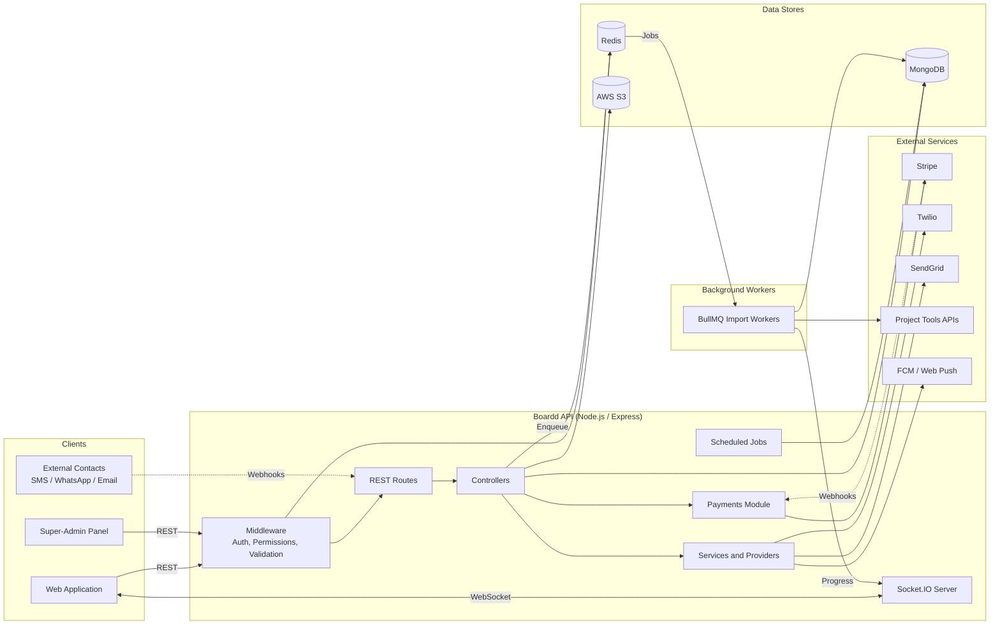
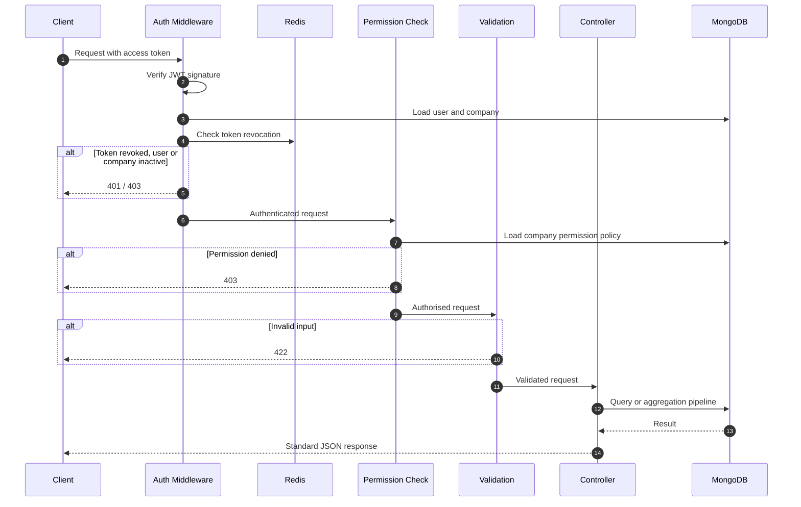
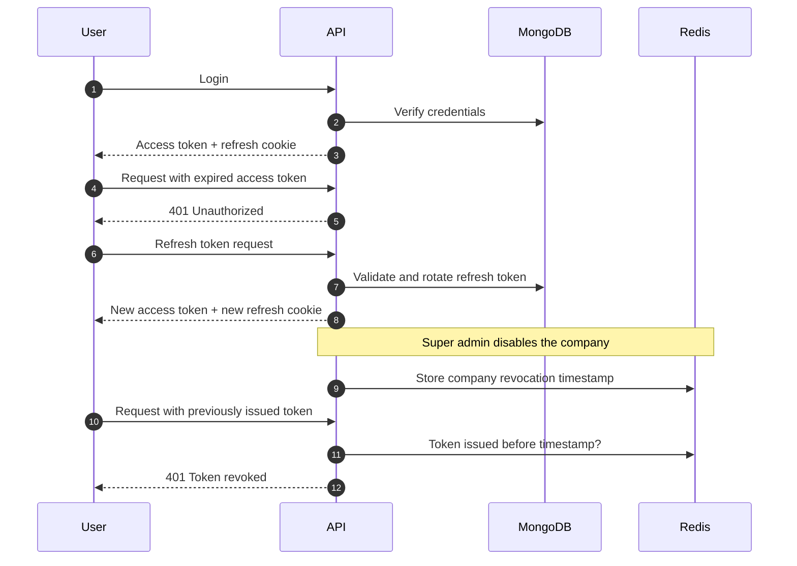
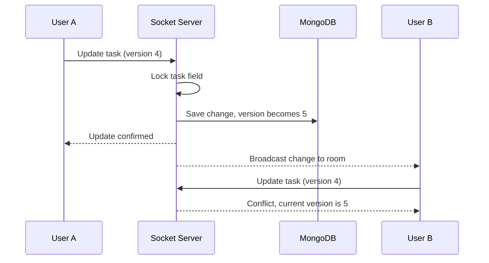
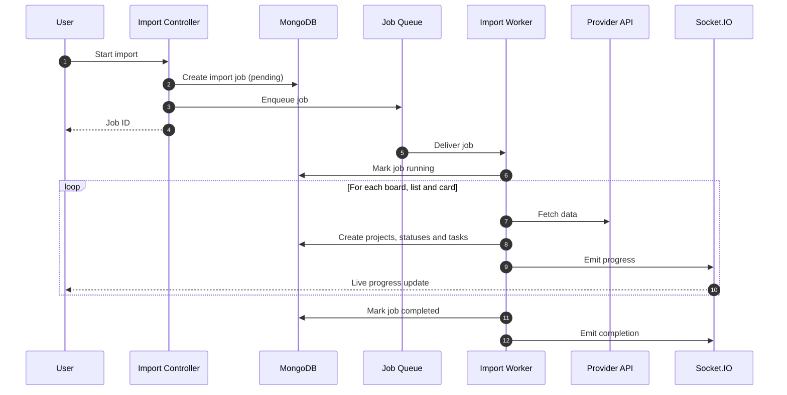
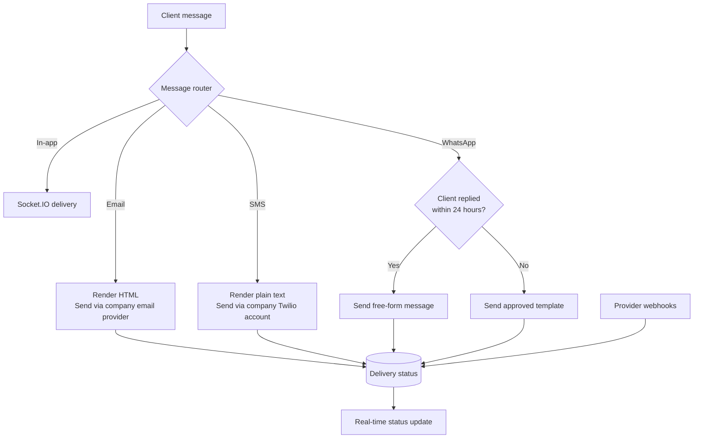
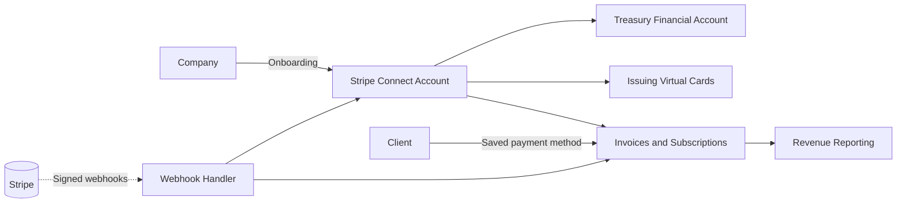
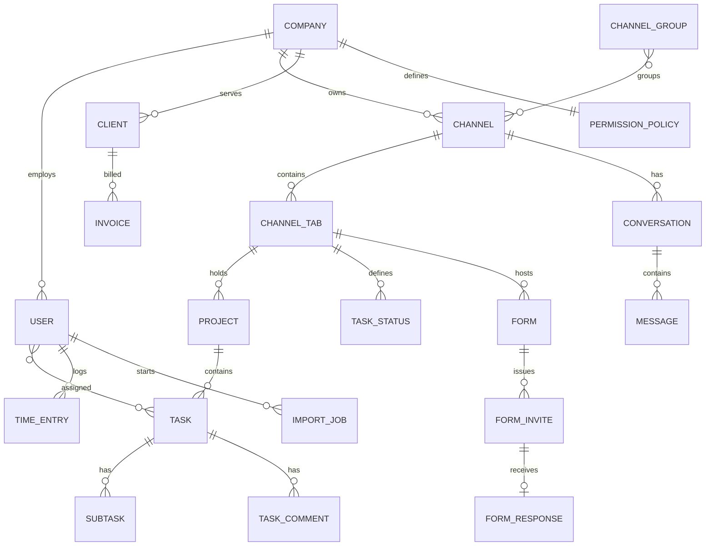
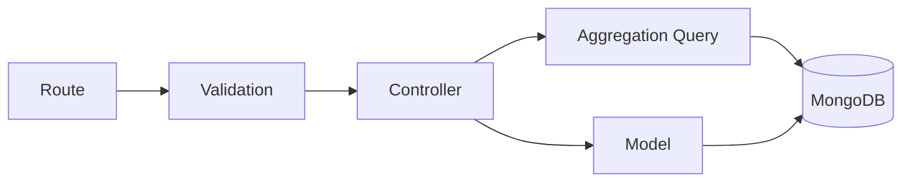
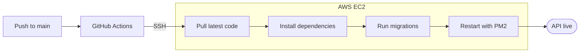

# Boardd API

Backend for **Boardd**, a multi-tenant business workspace that combines project management, real-time team and client communication, forms, time tracking, and embedded payments in one platform.


## Table of Contents

- [Overview](#overview)
- [Features](#features)
- [Tech Stack](#tech-stack)
- [Architecture](#architecture)
  - [System Overview](#system-overview)
  - [Request Lifecycle](#request-lifecycle)
  - [Authentication and Sessions](#authentication-and-sessions)
  - [Real-Time Collaboration](#real-time-collaboration)
  - [Background Import Jobs](#background-import-jobs)
  - [Omnichannel Messaging](#omnichannel-messaging)
  - [Payments Module](#payments-module)
  - [Data Model](#data-model)
- [Project Structure](#project-structure)
- [Getting Started](#getting-started)
- [API Reference](#api-reference)
- [Coding Conventions](#coding-conventions)
- [Deployment](#deployment)

## Overview

Boardd organises a company's work into **channels**. Each channel is split into **tabs**: team chat, client chat, tasks, files, forms, progress, client management and embedded content. This repository contains the REST API, the WebSocket server, background workers and scheduled jobs that power the web app and the super-admin panel.

Technical highlights:

- **Multi-tenant isolation.** All data is scoped to a company. Permission policies are configurable per company, and each tenant's third-party credentials are encrypted at rest with AES-256-GCM.
- **Instant session revocation.** Stateless JWTs are checked against Redis revocation lists at three levels: device, user and company.
- **Conflict-safe real-time editing.** Concurrent task edits use optimistic versioning with per-field locks.
- **Asynchronous imports.** Data from eight project-management tools is imported by BullMQ workers, with progress streamed live to the client.
- **Omnichannel delivery.** One message can be sent to in-app chat, email, SMS and WhatsApp at once.
- **Embedded finance.** Stripe Connect, Treasury and Issuing are implemented in an isolated payments module.

## Features

**Workspace and project management**

- Hierarchy: Company, Channel, Tab, Project, Task, Subtask
- Channel groups with drag-and-drop assignment
- Custom task statuses per tab, priorities, tags, due dates and multiple assignees
- Task comments with threaded replies and reactions, task links, view tracking and activity history
- Embedded tabs for Google Workspace, Figma, YouTube and custom URLs, with HTML sanitisation

**Communication**

- Real-time chat for channels, clients, direct messages and group messages
- Typing indicators, reactions, threads, message editing and unread counts
- Client messages delivered by email, SMS and WhatsApp, with inbound replies received through webhooks
- A Twilio sub-account and a SendGrid domain provisioned for each company, plus WhatsApp template management

**Data import**

- Trello, Asana, ClickUp, Monday.com, Jira, Notion, Linear and GitHub Issues
- OAuth connection for each provider, rate-limited API access and live progress reporting

**Payments and banking**

- Stripe Connect onboarding for each company
- Invoices, subscriptions and saved client payment methods
- Treasury financial accounts and Issuing virtual cards
- Per-company branding and revenue reporting for each client

**Forms**

- Form builder with 12 field types, plus templates and documents
- Single-use invite tokens for email, link and anonymous access
- Automatic task creation from form submissions

**Time tracking, notifications and administration**

- Start/stop timers with restartable sessions and PDF reports
- Notifications, task inbox and push notifications through FCM and Web Push
- Role-based access control with permission policies per company
- Super-admin console for company management, audit logs and platform statistics

## Tech Stack

| Category         | Technologies                                               |
| ---------------- | ---------------------------------------------------------- |
| Runtime          | Node.js, Express 5                                         |
| Database         | MongoDB, Mongoose 8                                        |
| Caching and jobs | Redis (ioredis), BullMQ                                    |
| Real-time        | Socket.IO 4                                                |
| Validation       | Joi                                                        |
| Authentication   | JWT, bcrypt, Google OAuth 2.0                              |
| Storage          | AWS S3, Multer                                             |
| Payments         | Stripe Connect, Treasury, Issuing                          |
| Messaging        | Twilio (SMS, WhatsApp), SendGrid, Nodemailer               |
| Notifications    | Firebase Cloud Messaging, Web Push                         |
| Documents        | PDFKit, docx, csv-parse                                    |
| Scheduling       | node-cron                                                  |
| Infrastructure   | Docker Compose, AWS EC2, PM2, GitHub Actions               |

## Architecture

### System Overview



Design decisions:

- **Modular monolith.** The API ships as a single deployable, with strict layering: route, then validation, then controller, then model. The payments module has its own boundary and can also run as a standalone service authenticated with a shared service key.
- **Non-blocking long-running work.** Imports are queued in BullMQ and processed by workers. The HTTP request returns immediately, and progress is pushed over WebSockets.
- **Redis has three roles:** token revocation, user presence, and BullMQ job storage.
- **Migrations run at startup.** Numbered migrations are tracked in the database and applied automatically at startup and during deployment.

### Request Lifecycle



### Authentication and Sessions

- Short-lived access tokens with a unique token ID (`jti`), plus rotating refresh tokens stored in an `httpOnly` cookie and tracked per device.
- Revocation in Redis at three levels:
  - **Device:** revokes a single token.
  - **User:** rejects every token issued before a stored timestamp ("sign out everywhere").
  - **Company:** rejects every token for a company once a super admin disables it.
- Device and location tracking for active sessions.
- Webhook requests from Twilio and Stripe are signature-verified.
- Super administrators use a separate identity collection and token type, so platform and tenant privileges never overlap.



### Real-Time Collaboration

Clients join scoped Socket.IO rooms, and each event goes to the smallest room that covers its audience.

| Room                     | Used for                                               |
| ------------------------ | ------------------------------------------------------ |
| `user:{userId}`          | Notifications, unread counts, import progress          |
| `channel:{channelId}`    | Task and project reordering, moves, tab activity       |
| `task:{taskId}`          | Live task editing and presence                         |
| Conversation rooms       | Chat messages, typing indicators, reactions, threads   |

Every task carries a version number. If two users edit the same field at the same time, the second update is rejected with a conflict response and the current version. Edits are never silently overwritten.



### Background Import Jobs

All eight import integrations share one pattern: a route, a controller, validation, a queue and a worker, built on a common set of worker helpers. Workers refresh OAuth tokens during long jobs and throttle calls to each provider's API.



Data is mapped onto Boardd's model. In the Trello example, boards become projects, lists become custom task statuses, and cards become tasks. Labels are imported as tags, checklists are preserved, and collaborators are matched to existing users by email.

### Omnichannel Messaging

A client message is written once in a rich-text editor. A message router then renders it for each delivery channel and sends it through interchangeable provider adapters.



### Payments Module

The payments module (`payments-service/`) has its own routes, controllers, services, models and validation. It is mounted at `/api/payments`.



### Data Model

Core entities and their relationships (simplified):



## Project Structure

```text
boardd-backend/
├── server.js            # Application entry point
├── api/                 # Route definitions, one class per domain
├── controller/          # Request handlers
│   ├── queries/         # MongoDB aggregation pipelines
│   ├── helpers/         # Domain-specific helper functions
│   └── webhooks/        # Twilio and SendGrid webhook handlers
├── models/              # Mongoose schemas and data-access helpers
├── validation/          # Joi request schemas
├── middlewares/         # Authentication, permissions, logging, error handling
├── services/            # Business logic and third-party integrations
├── providers/           # Message delivery adapters (in-app, email, SMS, WhatsApp)
├── payments-service/    # Stripe payments module
├── jobs/                # BullMQ queues, workers and pollers
├── utils/               # Socket.IO, Redis, encryption, cron, S3, shared helpers
├── migrations/          # Versioned database migrations
├── scripts/             # Maintenance and utility scripts
├── config/              # Database and provider configuration
├── public/              # Static pages (OAuth callbacks)
└── .github/workflows/   # CI/CD pipeline
```

Each feature follows the same layered structure:



## Getting Started

### Prerequisites

- Node.js 18 or later
- MongoDB and Redis, either installed locally or run through Docker

### Installation

```bash
git clone <repository-url>
cd boardd-backend
npm install
```

### Configuration

Create a `.env` file in the project root:

```bash
cp env_example .env
```

| Group        | Variables                                                                                  |
| ------------ | ------------------------------------------------------------------------------------------ |
| Server       | `PORT`, `NODE_ENV`, `BACKEND_URL`, `FRONTEND_URL`, `COOKIE_KEY`                            |
| Database     | `MONGODB_URL`, `REDIS_HOST`, `REDIS_PORT`, `REDIS_PASSWORD`                                |
| Security     | `JWT_SECRET`, `JWT_EXPIRATION`, `REFRESH_JWT_SECRET`, `REFRESH_JWT_EXPIRATION`, `ENCRYPTION_KEY` |
| Storage      | `AWS_ACCESS_KEY`, `AWS_SECRET_KEY`, `AWS_REGION`, `AWS_BUCKET_NAME`                        |
| Payments     | `STRIPE_SECRET_KEY`, `STRIPE_PUBLISHABLE_KEY`, `STRIPE_WEBHOOK_SECRET`                     |
| Messaging    | Twilio, SendGrid, SMTP and Meta (WhatsApp) credentials                                     |
| Push         | `FIREBASE_SERVER_KEY`, `VAPID_PUBLIC_KEY`, `VAPID_PRIVATE_KEY`                             |
| Integrations | OAuth client ID and secret for each import and cloud storage provider                      |

`ENCRYPTION_KEY` must be a 32-byte, base64-encoded key:

```bash
node -e "console.log(require('crypto').randomBytes(32).toString('base64'))"
```

### Running Locally

```bash
# Start MongoDB and Redis
docker compose up -d

# Start the API in development mode
npm run dev
```

At startup the server:

1. Connects to MongoDB and Redis.
2. Starts the background workers.
3. Applies pending migrations.
4. Starts the HTTP and WebSocket servers.
5. Schedules the cron jobs.

| Script        | Description                              |
| ------------- | ---------------------------------------- |
| `npm run dev` | Start with automatic reload (nodemon)    |
| `npm start`   | Start in production mode                 |

## API Reference

All endpoints are prefixed with `/api`. Authenticated endpoints expect an access token in the `accessToken` header.

| Domain             | Base paths                                                                                              |
| ------------------ | ------------------------------------------------------------------------------------------------------- |
| Authentication     | `/auth`, `/users`, `/invites`                                                                           |
| Organisation       | `/companies`, `/permissions`, `/admin`, `/user-status`                                                  |
| Channels           | `/channels`, `/channel-groups`, `/channel-tabs`                                                         |
| Projects and tasks | `/projects`, `/project-statuses`, `/project-status-columns`, `/tasks`, `/subtasks`, `/tasks-comments`, `/task-connections` |
| Communication      | `/chat`, `/messaging`, `/inbox`, `/notifications`, `/push`, `/webhooks`                                 |
| Clients and billing | `/clients`, `/payments`                                                                                |
| Forms              | `/forms`                                                                                                |
| Time and progress  | `/clockup`, `/work-progress`, `/team-cards`, `/home`, `/activities`                                     |
| Files and search   | `/upload`, `/cloud-integrations`, `/search`                                                             |
| Imports            | `/trello`, `/asana`, `/clickup`, `/monday`, `/jira`, `/notion`, `/linear`, `/github`, `/integrations`   |
| Platform admin     | `/super-admin`                                                                                          |

Responses use a consistent JSON envelope. Errors are returned with an HTTP status code and a descriptive message.

## Coding Conventions

- **Routes** are classes that expose `getRouter()` and `getRouterGroup()`, registered in a central route index.
- **Validation** runs as middleware before every handler, and validated values replace the raw request input.
- **Controllers** are async functions that pass errors to a central error-handling middleware.
- **Complex reads** are written as reusable aggregation pipelines, kept separate from controllers.
- **Tenant scoping** is applied to every query, and ownership is verified before every write.
- **Audit logging** records user activity and super-admin actions.

## Deployment

Every push to `main` triggers a GitHub Actions workflow that deploys to AWS EC2 over SSH. The deploy script stops at the first failed step.


